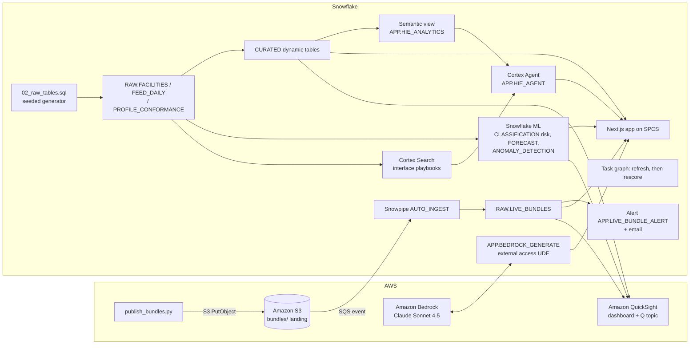

# Thailand Provincial Health Information Exchange - FHIR Feed Operations

Interface operations for **40 facilities connected to a fictional provincial health information exchange in Thailand**, spread across 5 Thai cities (Bangkok, Chiang Mai, Khon Kaen, Hat Yai, Phuket), built on Snowflake with an optional AWS layer. The demo follows one thread: a late or malformed FHIR bundle batch raises a live alert, Snowflake ML scores which facilities are likely to have an interface incident in the next 7 days, and an AI memo gives the exchange integration team three actions for the week. All data is synthetic and facility-level: there are no patient records, no patient identifiers and no clinical content.

## Architecture

**Snowflake** (Dynamic Tables, Snowflake ML, Cortex Search, Cortex Agent, Cortex AI_COMPLETE, SPCS) carries the whole pipeline; the full build adds **AWS** (Amazon S3, Bedrock Claude, QuickSight + Amazon Q). Bundle delivery events from the facilities land in `RAW.LIVE_BUNDLES`. Dynamic tables curate 90 days of facility-day history: bundles received and accepted against each facility's expected volume, data quality issues by type, interface incidents, remediation tickets, conformance check compliance and FHIR profile conformance. Snowflake ML scores 7-day interface incident risk per facility, forecasts accepted bundles for the whole exchange and flags unmapped code rate anomalies. A Cortex Agent answers questions and cites the exchange interface playbooks, and an LLM drafts the integration team's action memo.

Interactive diagrams (hover for object names): [Snowflake only](docs/architecture-snowflake.html) | [AWS + Snowflake](docs/architecture-aws.html). The app shows both on its Architecture & Data tab, the current build first. Regenerate them with `python3 docs/build_architecture.py`.



In the Snowflake-only build there is no AWS subgraph: `APP.SIMULATE_BUNDLES` writes to `RAW.LIVE_BUNDLES`, and the app calls Cortex `AI_COMPLETE` instead of the Bedrock UDF.

## Snowflake Capabilities

| Capability | Implementation |
|-----------|---------------|
| Dynamic Tables | `CURATED.KPI_SUMMARY`, `PERFORMANCE_SUMMARY`, `ISSUE_SUMMARY`, `TREND_ANALYSIS`, each built from the RAW tables |
| Snowflake ML | CLASSIFICATION of 7-day interface incident risk (`ML.INCIDENT_RISK_SCORES`), a 14-day accepted-bundle FORECAST, and ANOMALY_DETECTION on the unmapped code rate |
| Cortex Search | 14 synthetic exchange interface playbooks (one per source type and escalated issue type) in `SEARCH.FEED_SOP_SEARCH` |
| Semantic View | `APP.HIE_ANALYTICS` over facilities, cities, issue types, daily totals and risk |
| Cortex Agent | `APP.HIE_AGENT`: Cortex Analyst over the semantic view, plus Cortex Search for playbook citations |
| Cortex AI | `AI_COMPLETE('claude-sonnet-4-5')` for grounded answers, and for the action memo in the Snowflake-only build |
| Alerts + Tasks | `APP.LIVE_BUNDLE_ALERT` logs ALERT events and sends an email; task graph `TASK_REFRESH_CURATED`, then `TASK_RESCORE_RISK` |
| Snowpark Container Services | Next.js app `APP.TH_HEALTHCARE_HIE_APP` with 6 tabs: Executive Cockpit, Predictive, Conformance, Live Bundles, Ask AI, Architecture & Data |
| Snowpipe | `RAW.LIVE_BUNDLES_PIPE` AUTO_INGEST from S3 (AWS build only) |

## AWS Services

Only the AWS + Snowflake build uses these.

| Service | Role in Demo |
|---------|-------------|
| Amazon S3 | Landing bucket (`bundles/`). `aws/publish_bundles.py` writes each batch of simulated bundle delivery events with PutObject; an event notification goes to the Snowpipe SQS queue |
| Amazon Bedrock | Claude Sonnet 4.5 drafts the action memo, called from Snowflake through an external-access UDF |
| Amazon QuickSight | DIRECT_QUERY dashboard over Snowflake: accepted bundles and issues per day, interface incidents per facility, incident risk |
| Amazon Q | Natural-language questions over the QuickSight topic `th-healthcare-hie-topic` |
| AWS IAM | Least-privilege roles for S3 and Bedrock |

## Personas

Both personas are fictional.

| Persona | Role | Key Questions |
|---------|------|---------------|
| **Napat Srisuk** | Head of Exchange Integration | "Which cities and facilities are short of their expected bundle volume?" "Which issue types end up as interface incidents?" |
| **Pimchanok Wongsa** | Interface Operations Lead | "Which facilities should my team call this week, and which playbook applies?" |

## Data

All data is synthetic and HASH-seeded, so every rebuild reproduces it. The exchange, the facilities and the people are fictional; the cities are real Thai cities used only as regions. Tables hold facility-level daily counts only: there are no patient records, no patient identifiers and no clinical content, and nothing here is a clinical, medical or regulatory claim. FHIR appears only as generic resource and profile names.

| Table | Rows | Description |
|-------|------|-------------|
| RAW.FACILITIES | 40 | Connected facilities across 5 Thai cities and 5 source types (Hospital, Primary care, Laboratory, Pharmacy, Imaging), with integration tier and 90-day expected bundle volume |
| RAW.FEED_DAILY | 3,600 | Daily facility observations over 90 days: FHIR bundles received and accepted, data quality issues, interface incidents, remediation tickets, issue type, conformance checks, unmapped code rate and feed latency |
| RAW.PROFILE_CONFORMANCE | 40 | Required, conformant and pending FHIR profiles for each facility's main resource type |
| SEARCH.FEED_SOP_DOCS | 14 | Synthetic exchange interface playbooks indexed for Cortex Search |
| RAW.LIVE_BUNDLES | Grows during the demo | Live bundle delivery events from S3 (AWS build) or `APP.SIMULATE_BUNDLES` (Snowflake-only build) |
| ML.INCIDENT_RISK_SCORES | 40 | 7-day interface incident probability and risk band per facility |

## Build Instructions

### Prerequisites
- Snowflake account with ACCOUNTADMIN access, and Cortex AI enabled (AI_COMPLETE, Search, Agent).
- An X-Small warehouse with auto-suspend at or below 120 s, and an existing SPCS compute pool.
- Python 3.11+, `snowflake-connector-python`, Node.js 22+, Docker and the `snow` CLI.
- App image: run `snow spcs image-registry login`, then build and push `th-healthcare-hie-app:v1` to the database's `APP.IMAGES` repository (see the header of `snowflake/07_deploy_app.sql`).
- AWS build only: `boto3`, AWS credentials for the target account (us-west-2) with Bedrock access, and QuickSight Enterprise.

### SPCS App
```
<DATABASE>.APP.TH_HEALTHCARE_HIE_APP
```

### Tests
```bash
python -m pytest aws snowflake quicksight
```

For a local run, put `SNOWFLAKE_ACCOUNT`, `SNOWFLAKE_USER`, `SNOWFLAKE_DATABASE`, `SNOWFLAKE_WAREHOUSE`, `SNOWFLAKE_AUTHENTICATOR=PROGRAMMATIC_ACCESS_TOKEN`, `SNOWFLAKE_TOKEN` and `DEMO_PLATFORM` in the environment, then run `npm --prefix app run build && npm --prefix app start`.

## Build Modes

Both modes share the same core. They differ in three places, and the app's `DEMO_PLATFORM` setting (in its SPCS spec) switches the memo provider and the Live Bundles tab.

| Layer | Snowflake Only | Full AWS + Snowflake |
|---|---|---|
| Live bundle events | `CALL APP.SIMULATE_BUNDLES(n)` inserts simulated bundle delivery events into `RAW.LIVE_BUNDLES`. This simulates an interface engine feed; it is not Snowpipe Streaming | `aws/publish_bundles.py` uploads a batch to S3 with PutObject, then SQS and Snowpipe AUTO_INGEST |
| Action memo | Cortex `AI_COMPLETE('claude-sonnet-4-5')` | Amazon Bedrock Claude Sonnet 4.5 through `APP.BEDROCK_GENERATE` |
| BI and natural-language questions | The SPCS app is the dashboard; questions go to the Cortex Agent | Also a QuickSight dashboard and an Amazon Q topic |
| App setting | `DEMO_PLATFORM: snowflake` | `DEMO_PLATFORM: aws` |

### Snowflake Only

```bash
# 1. Core data and dynamic tables (guarded: new isolated database only)
python snowflake/run_core.py --database THAILAND_HEALTHCARE_HIE_SNOWFLAKE --warehouse <XS_WAREHOUSE> --connection <CONNECTION> --apply
# 2. Native bundle feed, ML, search, semantic view, agent, alert and task graph
python snowflake/run_intelligence.py --database THAILAND_HEALTHCARE_HIE_SNOWFLAKE --platform snowflake --warehouse <XS_WAREHOUSE> --connection <CONNECTION> --alert-email you@example.com
# 3. App on SPCS with DEMO_PLATFORM=snowflake (push the image first)
python snowflake/run_intelligence.py --database THAILAND_HEALTHCARE_HIE_SNOWFLAKE --platform snowflake --warehouse <XS_WAREHOUSE> --connection <CONNECTION> --alert-email you@example.com --files 07_deploy_app.sql --compute-pool <COMPUTE_POOL>
```

During the demo:
- Run `CALL APP.SIMULATE_BUNDLES(20)` to add live bundle delivery events. For a continuous feed, run `ALTER TASK APP.TASK_SIMULATE_BUNDLES RESUME`, and `SUSPEND` it afterwards.
- Run `EXECUTE ALERT APP.LIVE_BUNDLE_ALERT` to raise the alert email.
- Run `EXECUTE TASK APP.TASK_REFRESH_CURATED` to refresh the curated tables and rescore risk.

Afterwards, drop the database or run `ALTER SERVICE APP.TH_HEALTHCARE_HIE_APP SUSPEND`.

### Full AWS + Snowflake

```bash
# 1. Core data and dynamic tables (guarded: new isolated database only)
python snowflake/run_core.py --database THAILAND_HEALTHCARE_HIE_AWS --warehouse <XS_WAREHOUSE> --connection <CONNECTION> --apply
# 2. AWS ingestion and Bedrock (dry run first, then --apply)
python aws/setup_aws.py --database THAILAND_HEALTHCARE_HIE_AWS --account <AWS_ACCOUNT_ID> --connection <CONNECTION> --apply
# 3. ML, search, semantic view, agent, alert and task graph
python snowflake/run_intelligence.py --database THAILAND_HEALTHCARE_HIE_AWS --platform aws --warehouse <XS_WAREHOUSE> --connection <CONNECTION> --alert-email you@example.com
# 4. App on SPCS with DEMO_PLATFORM=aws (push the image first)
python snowflake/run_intelligence.py --database THAILAND_HEALTHCARE_HIE_AWS --platform aws --warehouse <XS_WAREHOUSE> --connection <CONNECTION> --alert-email you@example.com --files 07_deploy_app.sql --compute-pool <COMPUTE_POOL>
# 5. QuickSight dashboard and Q topic (needs an existing Snowflake data source)
python quicksight/build_dashboards.py --database THAILAND_HEALTHCARE_HIE_AWS --account <AWS_ACCOUNT_ID> --principal-arn <QUICKSIGHT_USER_ARN> --data-source-arn <DATA_SOURCE_ARN> --prefix th-healthcare-hie --apply --update --with-topic
```

QuickSight objects must be shared with the QuickSight user who signs in (`--principal-arn`); otherwise the console shows nothing.

During the demo:
- Run `python aws/publish_bundles.py --account <AWS_ACCOUNT_ID> --count 20` to upload live bundle delivery events. Snowpipe loads each object within about a minute.
- Run `EXECUTE ALERT APP.LIVE_BUNDLE_ALERT` to raise the alert email.
- Run `EXECUTE TASK APP.TASK_REFRESH_CURATED` to refresh the curated tables and rescore risk.

Afterwards, `python aws/teardown_aws.py --database THAILAND_HEALTHCARE_HIE_AWS --account <AWS_ACCOUNT_ID> --connection <CONNECTION> --apply` removes the AWS resources and the account-level Bedrock external-access and S3 storage integrations. It leaves the email integration `TH_HEALTHCARE_HIE_EMAIL_INT`, which the Snowflake-only build also uses.

## Business Impact

Snowflake customer outcome:
- **AMN Healthcare** (Snowflake customer): rearchitecting its data environment with Snowflake and Microsoft Azure Data Factory "has led to a 99.9% pipeline success rate and a 75% reduction in data warehouse runtime", and the company expects "a savings of $2.2 million dollars" a year while storing approximately 50% more data -- [Snowflake customer story: AMN Healthcare](https://www.snowflake.com/en/customers/all-customers/case-study/amn-healthcare/)

## Key Demo Numbers

These figures are synthetic and come from the seeded demo data.

- **40 facilities**, 3,600 facility-days over 90 days, across 5 Thai cities and 5 source types
- **410,713 FHIR bundles accepted** against 447,591 expected, so feed completeness is **91.8%**; 19 facilities are below 90% of their expected volume. 436,566 bundles were received, a 5.9% bundle rejection rate
- **521 data quality issues** raised and **121 escalated** as interface incidents, a 23.2% issue escalation rate; **60 remediation tickets** opened
- **Date sequence error (37 incidents from 154 issues)** produces the most interface incidents; the 16 city-wide network outage issues (Chiang Mai and Hat Yai) are never escalated
- **Phuket facilities record the most interface incidents (32 of 121), while Bangkok has the lowest feed completeness of the 5 cities (90.0%)**
- **Interface incident model** out-of-time holdout (592 facility-days): precision 0.425, recall 0.337 at a 0.5 threshold, against a 0.171 base rate. Seven facilities are high risk; the top facility is FAC-0032, at 78.9%
- **14-day accepted-bundle forecast** of 4,376 to 4,635 bundles per day across the exchange, with prediction intervals; **33 of 640** facility-days flagged as unmapped code rate anomalies. The data is identical on every build, but dates are relative to the build day, so forecast and anomaly figures can shift slightly with the build day
- **Conformance check compliance 78.7%**, FHIR profile conformance 63.6%, with 19 profile reviews pending
- **14 playbooks** indexed for Cortex Search and cited by ID in agent answers

## License

Apache 2.0 — See [LICENSE](LICENSE) for details.

This is a personal demo project and is not an official Snowflake offering. It comes with no support or warranty. It uses synthetic data only and provides no medical, clinical, legal or regulatory advice. The exchange, facilities and personas are fictional. Customer outcomes cited are from publicly available Snowflake customer stories; they represent reported outcomes and are not guarantees of results.
